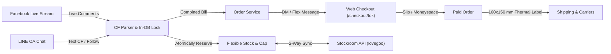

# ChatbotXERP Documentation 📖

Welcome to the **ChatbotXERP** official documentation.

ChatbotXERP is an omnichannel e-commerce and live selling ERP platform designed specifically for high-volume Facebook Live and LINE Official Account sellers, fashion retailers, and direct-to-consumer brands.

---

## 🚀 Key Capabilities

### 1. High-Concurrency Live CF Automation
- Real-time comment ingestion via Facebook Graph Webhooks and LINE Messaging API.
- Intelligent regex parsing for Thai and English CF codes (`CF A01 2`, `ซีเอฟ ก01 1`).
- Atomic row reservation prevents overselling and duplicate bookings during high-traffic streams.

### 2. Flexible Stock & Overbooking Cap
- Separate tracking of physical inventory, reserved stock, and incoming backorder quota (`maxCapQuantity`).
- Automatic 24-hour expiration cron releases held stock back to available inventory.

### 3. Integrated Fulfillment & Shipping
- Printable 100x150 mm thermal shipping labels with SVG vector barcodes and packing checklists.
- 1-click tracking generation for Flash Express, J&T Express, Kerry, Thailand Post, and SPX Express.

### 4. Real-Time Analytics & AI Recovery
- Realized vs. potential revenue KPI tracking during live streams.
- 1-click AI Cart Recovery reminders to convert pending bills into paid orders.

---

## 🧭 Navigation

- [Architecture & Tech Stack](architecture.md)
- [Deployment & VPS Setup](deployment-guide.md)
- [Stock & Flexible Cap System](stock-cap-system.md)
- [Facebook Live CF Automation](facebook-live-cf.md)
- [LINE OA Integration](line-oa-integration.md)
- [Orders & Web Checkout](orders-and-checkout.md)
- [Shipping & Fulfillment Labels](shipping-and-fulfillment.md)
- [Live Sales Analytics](live-sales-analytics.md)
- [Stockroom API Sync](stockroom-sync.md)
- [Webhook Reference](webhooks-reference.md)
