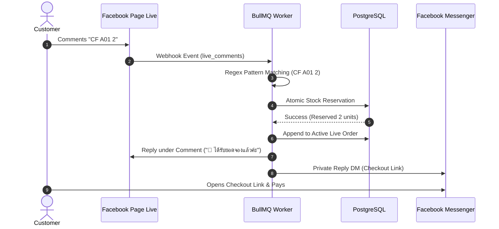

# Facebook Live CF Automation

## How It Works

---

## Supported Comment Patterns

The CF Parser recognizes:
- `CF <CODE> <QTY>` (e.g. `CF A01 2`, `cf b12 1`)
- `CF <CODE>x<QTY>` (e.g. `CF A01x2`)
- Thai variations: `ซีเอฟ A01 1`, `จอง A01 2`, `เอา A01 1`
- Single code shorthand: `A01` (when live code matching is enabled)

---

## Meta App Permissions Required

To operate Facebook Live CF automation in production, your Meta App needs:
- `pages_messaging`
- `pages_read_engagement`
- `pages_manage_metadata`
- `pages_read_user_content`
